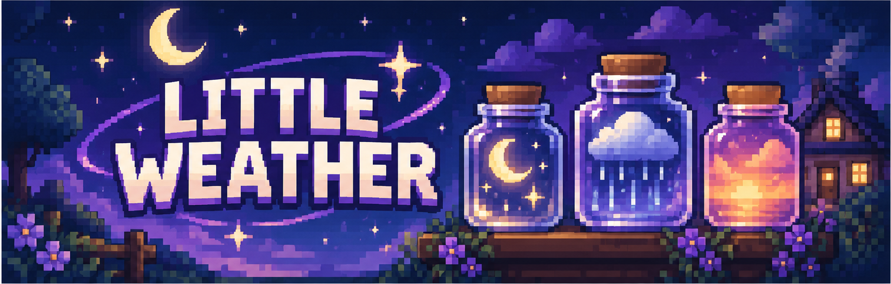

<p align="center">
  
</p>

<h1 align="center">Little Weather</h1>

<p align="center">
  <b>Keep the sky in a jar.</b> Catch a starry night, a rain cloud, a sunset, snowfall and a thunderstorm in little glass jars, then stand or hang them around your cottage, garden, library or bedroom. A small Fabric mod for Minecraft Java.
</p>

<p align="center">
  <a href="../../releases/latest"></a>
  <a href="https://fabricmc.net/use/"></a>
  <a href="https://fabricmc.net/use/"></a>
  
</p>

---

## Install

1. Install [Fabric Loader](https://fabricmc.net/use/) for **Minecraft 26.3** (Java 25).
2. Download [Fabric API](https://modrinth.com/mod/fabric-api) and put it in your `mods` folder.
3. Download the newest `little-weather-<number>.jar` from the [latest release](../../releases/latest) and drop it in the same `mods` folder.
4. Launch the game. The config is generated at `config/littleweather.json`.

> Works in singleplayer and on dedicated servers. Install it on the server **and** on every client (it adds blocks and items).

## How to play

1. Craft an **Empty Weather Jar**.
2. Stand under open sky at the right moment and **right-click** with the jar.
3. The sky goes into the jar. Place it anywhere you like. Break it to pick it up again.

| Jar | When to catch it | Look | Glow |
|---|---|---|---|
| **Star Jar** | Overworld, clear dark night, open sky above you | Twinkling stars and a crescent moon | Brightest (light 9) |
| **Rain Jar** | Overworld, rain that actually falls on your spot, open sky | A tiny cloud with falling drops | Faint (light 3) |
| **Sunset Jar** | Overworld, evening glow, open sky | Orange, gold and pink sky over little hills, slowly shifting | Warm (light 6) |
| **Snow Jar** | Overworld, snowfall in a cold biome, open sky | Drifting flakes under a pale cloud | Soft (light 5) |
| **Storm Jar** | Overworld, thunderstorm, open sky | Dark cloud, driving rain and lightning | Dim (light 4) |

If the conditions are wrong, you keep the jar and the action bar tells you what is missing. Capturing never needs creative mode, commands or cheats.

**Placing:** click the top or side of a block to stand a jar up, or click the **underside** of a block to hang it from a twine loop, like a lantern. A jar needs something to carry it and drops as an item if that block is removed.

Placed jars give off a few tiny ambient particles: twinkles, droplets, drifting sunset motes, snowflakes, storm sparks.

**Advancements:** *A Jar for the Sky*, *Caught Something*, *Sky Collector* (own all five jars).

## Recipe

**Empty Weather Jar**

```
 W         W = any planks
P A P      P = glass pane
P P P      A = amethyst shard
```

Filled jars have no recipes on purpose: the only way to get one is to catch the sky.

## Config

`config/littleweather.json` (times are ticks of the day: 0 = sunrise, 6000 = noon, 12000 = sunset, 18000 = midnight)

| Option | Default | Meaning |
|---|---|---|
| `sunsetStart` / `sunsetEnd` | 11800 / 13600 | Sunset capture window |
| `nightStart` / `nightEnd` | 13800 / 22200 | When stars can be caught |
| `cooldownTicks` | 20 | Cooldown after every use (stops accidental double captures) |

The default sunset window is centred on the moment the sun touches the horizon (about tick 12785). Precipitation takes priority over sunset and night. A thunderstorm gives a Storm Jar, rain a Rain Jar, snowfall a Snow Jar.

## Build from source

Needs JDK 25.

```
./gradlew build
```

The jar is written to `build/libs/little-weather-<version>.jar`. Pushing to GitHub builds it automatically (see `.github/workflows/build.yml`).

Art and data are generated by scripts in `tools/` (Python with Pillow and numpy; sounds also need ffmpeg):
`generate_textures.py`, `generate_models.py`, `generate_sounds.py`. `check_resources.py` verifies that every model, texture, sound, loot table, recipe, advancement and lang key resolves, and `preview_jars.py` renders a rough preview of the jar models.

## Releases

Every update gets its own GitHub release (`v1`, `v2`, ...). To ship one: bump `version` in `gradle.properties`, add `.github/changes/<version>.md` (NEW / FIXED / CHANGES) and an entry in `CHANGELOG.md`, then push. Old releases are never overwritten. See the [changelog](CHANGELOG.md).

## Build status (v2)

v1 was built by GitHub Actions and failed with exactly two compile errors (a `ServerPlayer.drop` call whose signature changed in 26.3); that is fixed in v2. Everything else in v1 compiled. **v2 has not been built yet and nothing has been tested in game**: it was written without access to a JDK 25 or the Minecraft jars. What was checked offline: Java syntax (parse only), JSON validity, resource references (`tools/check_resources.py`) and a software preview of the models. Newer code (hanging block state, `randomTick`, snow detection, sounds, lore) is the most likely place for a compile error against 26.3; report any and they get fixed in the next update.
